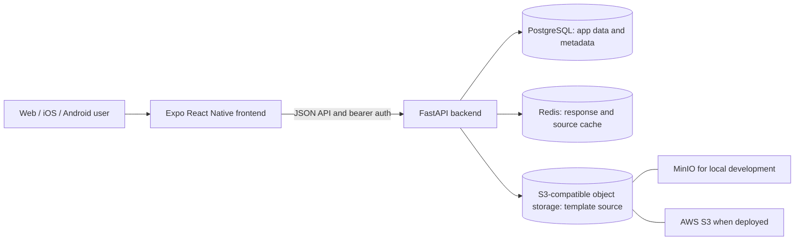

# Job Buddy

Job Buddy is a cross-platform resume and job-search workspace. The repository is split into an Expo frontend and a FastAPI backend; each has its own architecture and setup guide:

- [Frontend architecture and development guide](frontend/README.md)
- [Backend architecture, API, and development guide](backend/README.md)

## Overall architecture



The frontend is in `frontend/`; it owns screens, navigation, reusable components, theme, and the typed API client. The backend is in `backend/`; it owns REST endpoints, validation, admin authentication/RBAC, persistence, caching, object storage, and resume exports. PostgreSQL is the source of truth for application records and template metadata. Large template text is stored in MinIO locally or AWS S3 using the same S3 API adapter.

## Run the full stack with Docker Compose

1. Create the root Compose environment file and replace the admin placeholders with unique values. `ADMIN_JWT_SECRET` must be at least 32 characters.

   ```sh
   cp backend/.env.example .env
   ```

2. Start PostgreSQL, Redis, MinIO, and the API from the repository root:

   ```sh
   docker compose up --build
   ```

3. In another terminal, install and start the frontend:

   ```sh
   cd frontend
   npm ci
   EXPO_PUBLIC_API_URL=http://localhost:8000 npm start
   ```

The API docs are at `http://localhost:8000/docs`; MinIO's console is at `http://localhost:9001`. Set `EXPO_PUBLIC_API_URL` to the development machine's LAN address when using a physical phone. For Expo web from another device, also include that frontend origin in `CORS_ORIGINS` in the root `.env`.

## Run frontend and backend separately

For frontend-only work, follow [frontend/README.md](frontend/README.md). For the backend on the host, start its dependencies from the repository root:

```sh
docker compose up -d postgres redis minio
```

Then configure `backend/.env` from its example, install Python dependencies, and start Uvicorn as described in [backend/README.md](backend/README.md). Use `EXPO_PUBLIC_API_URL=http://localhost:8001` if running the API on port `8001`.

## Admin access

The first admin is bootstrapped from `ADMIN_BOOTSTRAP_EMAIL` and `ADMIN_BOOTSTRAP_PASSWORD`. Admin endpoints use short-lived bearer tokens and role-based permissions. Keep real secrets in local environment files or deployment secret storage; `.env` files are ignored by Git. See the [backend admin guide](backend/README.md#admin-auth-and-permissions) for login, role, and permission routes.
