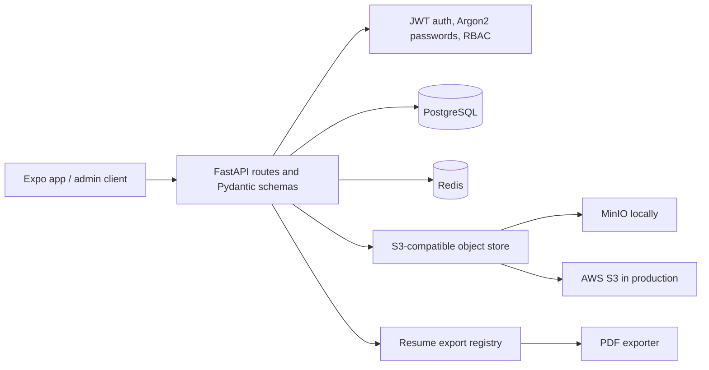

# Job Buddy Backend

FastAPI service for resume, template, profile, and admin operations. The repository's overall system diagram and full-stack run guide are in the [root README](../README.md).

## Backend architecture



- `app/routes/` exposes API endpoints; `app/schemas.py` validates the camelCase API contract.
- `app/models.py` defines PostgreSQL records. Redis caches reads and template source text; cache failures fall back to PostgreSQL/object storage.
- `app/object_storage.py` wraps the S3 API through boto3. Local MinIO and AWS S3 use the same adapter. PostgreSQL stores template source keys, checksums, sizes, and placeholder definitions; source text is read from object storage on demand.
- `app/admin_security.py` provides signed bearer-token authentication and permission checks. Role/user administration is in `app/routes/admin.py`.
- `app/exports/` contains the format-neutral resume exporter interface and registry. PDF is registered by default.

## Run locally

From the repository root, start Postgres, Redis, and MinIO:

```sh
docker compose up -d postgres redis minio
```

Configure backend settings and initial admin credentials:

```sh
cd backend
cp .env.example .env
```

Edit `backend/.env`: replace `ADMIN_JWT_SECRET` with a random value of at least 32 characters and set a strong unique `ADMIN_BOOTSTRAP_PASSWORD`. Then install dependencies and run the API:

```sh
python3 -m venv .venv
source .venv/bin/activate
pip install -r requirements.txt
uvicorn app.main:app --reload --port 8000
```

OpenAPI docs are at `http://localhost:8000/docs`. The API creates new tables and applies the small additive template/admin columns at startup. Existing template source text in PostgreSQL migrates to object storage when first fetched or forked.

To run the complete Compose stack instead, follow the [root run guide](../README.md#run-the-full-stack-with-docker-compose).

## API reference

| Method | Path | Purpose |
| --- | --- | --- |
| GET | `/health` | Health status |
| GET, POST | `/api/resumes` | List/search and create resumes |
| GET, PATCH, DELETE | `/api/resumes/{id}` | Read, update, or delete a resume |
| POST | `/api/resumes/{id}/duplicate` | Duplicate a resume |
| GET | `/api/resumes/{id}/download?format=pdf` | Download in a registered file format |
| GET | `/api/templates` | Browse template metadata |
| POST | `/api/templates` | Create a template; requires bearer permission `templates:create` |
| GET, PATCH | `/api/templates/{id}` | Read metadata or update bookmark state |
| GET | `/api/templates/{id}/source` | Fetch full template source on demand |
| POST | `/api/templates/{id}/fork` | Create a resume from a template |
| POST | `/api/admin/auth/login` | Admin login; returns an access token |
| POST | `/api/admin/auth/change-password` | Change password and revoke existing tokens |
| GET | `/api/admin/me` | Inspect the authenticated admin |
| GET | `/api/admin/me/permissions` | Inspect the current role and effective permissions |
| GET | `/api/admin/roles` | List roles and permission grants (`roles:read`) |
| GET, POST | `/api/admin/users` | List or create admin users (`users:read` / `users:manage`) |
| PATCH | `/api/admin/users/{id}/role` | Update role, permission override, or active state (`users:manage`) |
| GET, POST | `/api/admin/templates` | List or create templates (`templates:read` / `templates:create`) |
| GET, PUT, PATCH | `/api/profile` | Read or update the operator profile |

Admin roles are `super_admin`, `admin`, `editor`, and `viewer`. Only `super_admin` can manage admin users or grant elevated permissions. Roles are reloaded from PostgreSQL for every protected request so changes apply immediately. Both template-creation routes require the same `templates:create` grant.

## Creating a template

Send full UTF-8 template text in `source` (maximum 2 MB) and variable definitions in `placeholders`. The response contains metadata, not the large source field; fetch source with `/api/templates/{id}/source` when a client opens it.

```json
{
  "title": "Software Engineer Resume",
  "source": "{{fullName}}\\n{{#extras}}{{key}}: {{value}}{{/extras}}",
  "placeholders": {
    "fullName": { "type": "string", "required": true, "maxLength": 120 },
    "extras": {
      "type": "array", "required": false, "maxItems": 20,
      "item": {
        "key": { "type": "string", "required": true, "maxLength": 80 },
        "value": { "type": "string", "required": true, "maxLength": 500 }
      }
    }
  }
}
```

Supported placeholder types are `string`, `number`, `boolean`, `array`, and `object`; array and string bounds include `maxItems`, `maxLength`, and `itemMaxLength`. `extras` is a reserved array of repeatable custom key/value strings.

## Admin auth and permissions

On first startup, the configured bootstrap email/password creates the initial `super_admin`. Login with JSON `{ "email": "...", "password": "..." }` at `/api/admin/auth/login`, then send `Authorization: Bearer <accessToken>` to protected endpoints. The token lifetime is configured by `ADMIN_TOKEN_TTL_MINUTES` (default 60). Passwords use Argon2 hashes; tokens use HS256 and require `ADMIN_JWT_SECRET` of at least 32 characters.

Role grants:

| Role | Default grants |
| --- | --- |
| `super_admin` | All permissions |
| `admin` | Read/create templates, read users and roles |
| `editor` | Read/create templates, inspect roles |
| `viewer` | Read templates, inspect roles |

Set `OBJECT_STORAGE_ENDPOINT_URL` to MinIO for local development. For AWS S3, leave the endpoint empty, configure the region and standard AWS credential chain, and set the target bucket. Compose uses path-style requests for MinIO; AWS uses the default addressing mode. Configure production secrets, TLS, authentication, per-user profile ownership, database migrations, and deployment-specific CORS before public deployment.
