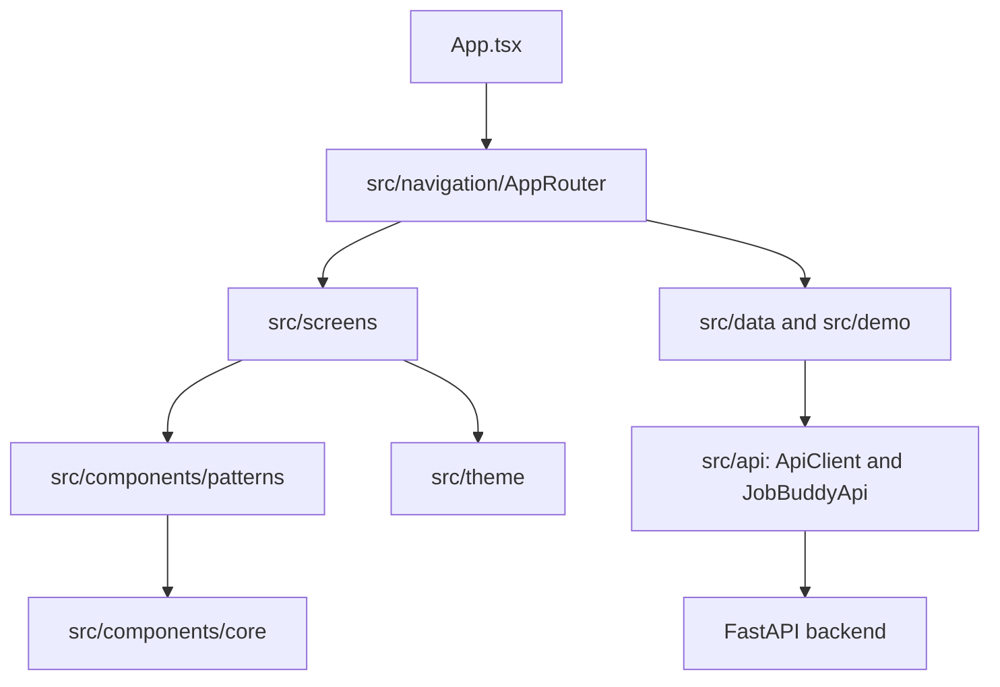

# Job Buddy Frontend

Expo React Native client for web, iOS, and Android. The overall system architecture and full-stack run guide are in the [root README](../README.md).

## Frontend architecture



- `App.tsx` mounts the app shell and theme.
- `src/navigation/` routes between the major areas and manages the resume/template library flow.
- `src/screens/` contains page-level UI. `src/components/patterns/` provides composed product components; `src/components/core/` contains reusable primitives.
- `src/theme/` owns design tokens and theme state.
- `src/data/`, `src/demo/`, and `src/mocks/` provide the local preview data. When `EXPO_PUBLIC_API_URL` is configured, the app starts with empty API-backed state instead of preview records.
- `src/api/` contains the injectable transport, request/response handling, and typed adapters for resumes, templates, profiles, and admin endpoints.
- `tests/` contains frontend component, API-client, and integration test suites.

## Setup and run

From this folder:

```sh
npm ci
npm start
```

To start the browser target:

```sh
npm run web
```

To use the API, set its base URL before starting Expo:

```sh
EXPO_PUBLIC_API_URL=http://localhost:8000 npm start
```

For an iOS/Android device, use the development machine's LAN address instead of `localhost`, for example `EXPO_PUBLIC_API_URL=http://192.168.1.10:8000`. Start the backend and its services using the [root guide](../README.md#run-the-full-stack-with-docker-compose). For API-backed Expo web, add the frontend origin to backend CORS settings.

## Useful commands

```sh
npm run typecheck
npm test
npm run test:unit
npm run test:integration
```

## Data and API usage

Construct `ApiClient` with the backend URL and inject it into `JobBuddyApi`. The adapter covers resume CRUD and PDF download, template browsing/source retrieval/admin creation, admin login and role/permission checks, and profile reads/writes. Admin calls pass the login token as a bearer header. The client supports JSON, text, and blob responses, request cancellation, timeouts, and injected headers/transport.
